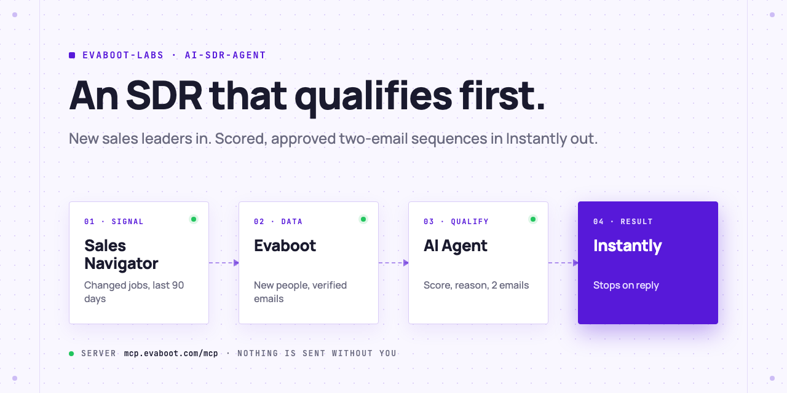
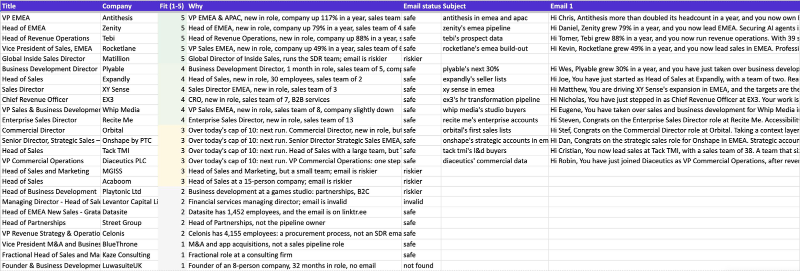
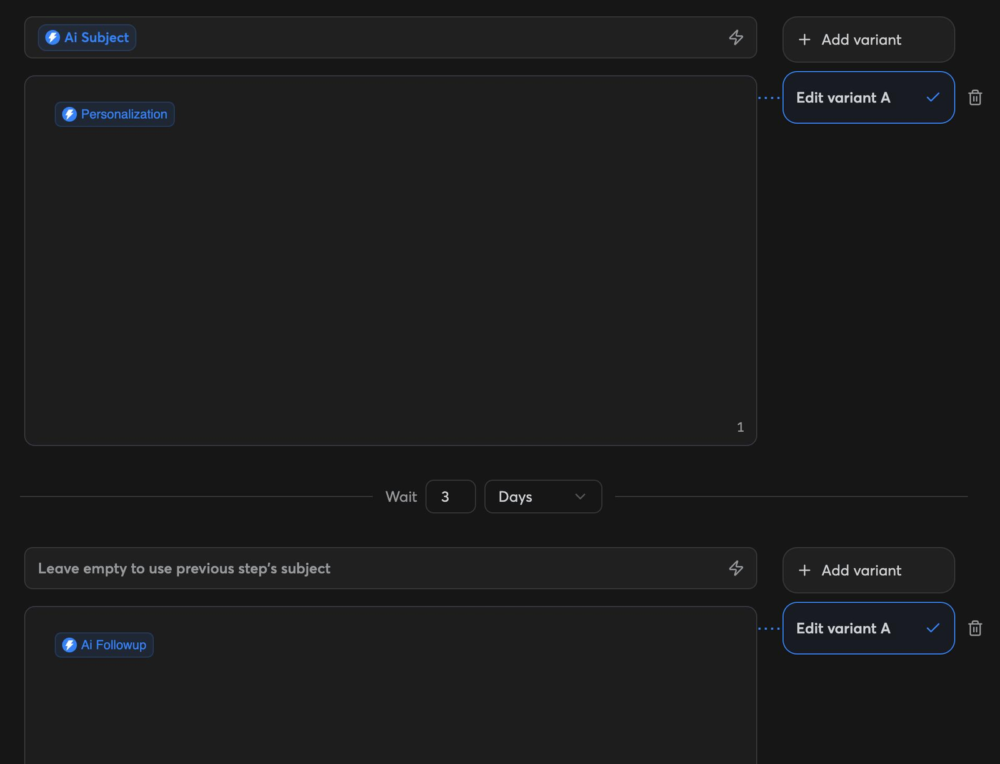
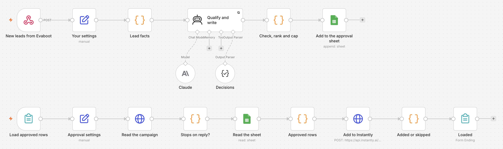

<picture>
  <source media="(prefers-color-scheme: dark)" srcset=".github/assets/banner-dark.png">
  
</picture>

# AI SDR agent

Your AI Agent watches a Sales Navigator search for a buying signal, exports the new people with Evaboot, scores each one against your ICP, and writes a two-email sequence for the ones that fit. You approve. The approved sequences load into an Instantly campaign that stops on reply.

[](AGENTS.md)
[](https://evaboot.com/mcp)
[](LICENSE)

## Set it up in one prompt

Paste this into Claude Code, Codex or Cursor:

```text
Clone https://github.com/evaboot-labs/ai-sdr-agent, read AGENTS.md and follow the skill. Run my AI SDR on sales leaders who just changed jobs.
```

<details>
<summary>Or install the skill</summary>

Claude Code:

```text
/plugin marketplace add evaboot-labs/ai-sdr-agent
/plugin install ai-sdr-agent@evaboot-labs-ai-sdr-agent
```

Codex, Cursor and other agents:

```bash
npx skills add evaboot-labs/ai-sdr-agent
```

</details>

## How it works

**1. Every lead is qualified, with a reason.** The agent scores each new person from 1 to 5 against [`ICP.md`](ICP.md) and writes why in one line. Only 3 and above get a sequence, best fit first, up to your daily cap.



**2. Two emails per fit, checked.** A first email built on one real hook, and a follow-up with a new angle. A script checks length, links, template phrases, repeated sentences and the email domain.



**3. Stops on reply, never doubles up.** The push refuses a campaign without stop on reply, and skips anyone who is already in another campaign.

**4. Or run it in n8n.** An Evaboot recurring export posts each week's new people to a webhook. Claude fills your sheet; a form loads the rows you approve.



## What you need

- An [Evaboot account](https://dash.evaboot.com/accounts/signup/?last_click_origin=ai-sdr-agent-repo) and a Sales Navigator seat.
- An Instantly account with a campaign set up as in [docs/instantly.md](docs/instantly.md).
- An AI Agent that can use an MCP server: Claude Code, Codex, Cursor, or the n8n version.
- Python 3.9+, with no packages to install.
- Cost: 1 Evaboot credit per exported lead. The search preview is free, and a recurring export only pays for new people.

## Go further

| Page | For |
|---|---|
| [docs/connect-your-agent.md](docs/connect-your-agent.md) | The setup by hand, for each agent |
| [docs/instantly.md](docs/instantly.md) | The two-step campaign the sequences load into |
| [docs/n8n.md](docs/n8n.md) | The same SDR in n8n, fed by a recurring export |
| [ICP.md](ICP.md) | Who fits, your offer, the sequence rules and the daily cap |

---

Agents: start at [AGENTS.md](AGENTS.md) · Built by [Evaboot](https://evaboot.com) · More workflows at [github.com/evaboot-labs](https://github.com/evaboot-labs) · [MIT license](LICENSE)
